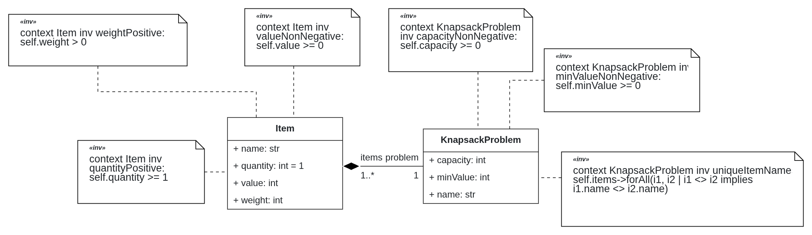
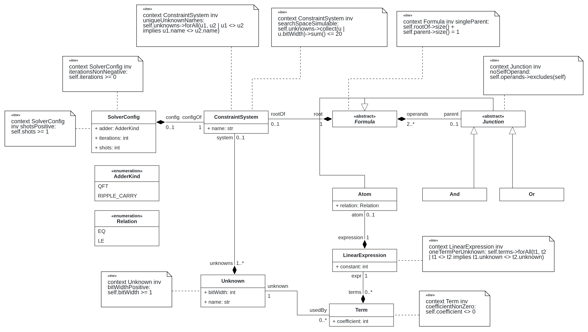

# TACS-G9 — QMDE: Knapsack Feasibility (Class C2)

Quantum Model-Driven Engineering assignment (TACS 2026/27, FEUP).
Problem: **knapsack feasibility** — given items with weights and values, is there a choice whose total weight is ≤ C and total value is ≥ V?
Class C: the problem is translated into a system of **linear integer constraints** and solved with **Grover search** using reversible adders and comparators.

## Transformation chain

| Layer | Artefact | Status |
|---|---|---|
| Problem DSL | Knapsack problem metamodel + OCL ([`problem_metamodel.py`](problem_dsl/problem_metamodel.py)) | Part I |
| Solution DSL | Linear integer constraints metamodel + OCL ([`solution_metamodel.py`](solution_dsl/solution_metamodel.py)) | Part I |
| T1 | Problem model → solution model | Part II |
| T2 | Solution model → BESSER quantum circuit model | Part II |
| T3 | Quantum model → Qiskit code (BESSER generator) | Part II |

## Setup

Requires Python 3.10–3.12 (BESSER does not install on 3.13).

```bash
python -m venv venv
source venv/bin/activate        # Windows: venv\Scripts\activate
pip install -r requirements.txt
python -c "import besser; print('BESSER ok')"
```

BESSER is installed from the course fork: [jacomecunha/BESSER](https://github.com/jacomecunha/BESSER)

## Part I deliverables

| Deliverable | Reference | Status |
|---|---|---|
| Problem DSL metamodel + 6 OCL invariants | [`problem_dsl/problem_metamodel.py`](problem_dsl/problem_metamodel.py) | Done |
| Solution DSL metamodel + OCL invariants | [`solution_dsl/solution_metamodel.py`](solution_dsl/solution_metamodel.py) | Done |
| Problem DSL class diagram (with OCL) | [`docs/problem_class-diagram.png`](docs/problem_class-diagram.png) | Done |
| Solution DSL class diagram (with OCL) | [`docs/solution_class-diagram.png`](docs/solution_class-diagram.png) | Done |
| Concept lists (problem + solution DSL) and problem → solution mapping, with references | `docs/` | To do |
| Hand-built example models (problem + solution) | [Object tables, links, and expected T1 output](docs/example_object_models.md) | Done |
| Test instances + brute-force checker | [`instances/`](instances/) | To do |
| Report | [`docs/report_part1.md`](docs/report_part1.md) | To do |
| LLM usage log | [`LLM_LOG.md`](LLM_LOG.md) | To do |

### Diagrams

**Problem DSL**



**Solution DSL**



## Structure

| Folder | Content |
|---|---|
| [`problem_dsl/`](problem_dsl/) | Problem metamodel + OCL |
| [`solution_dsl/`](solution_dsl/) | Solution metamodel + OCL |
| [`models/`](models/) | Example models |
| [`instances/`](instances/) | Test instances + brute-force checker |
| [`docs/`](docs/) | Reports, concept tables, diagrams |
| [`LLM_LOG.md`](LLM_LOG.md) | LLM usage log |

## Group

| Student no. | Name |
|---|---|
| 202205682 | João Francisco Costa Cordeiro |
| 202108696 | Lino Branco Vaz |
| 202206289 | Nuno Pinho Fernandes |
| 202108852 | Inês Martin Soares |
