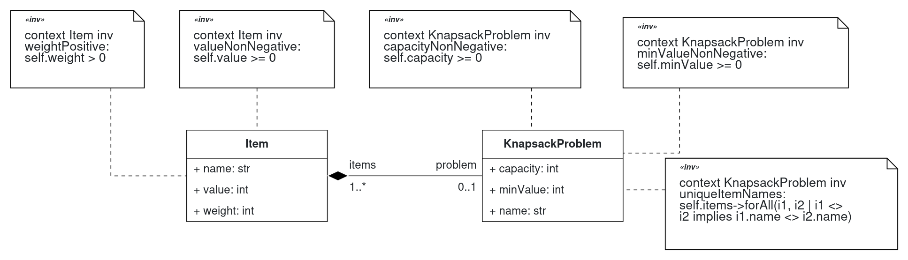
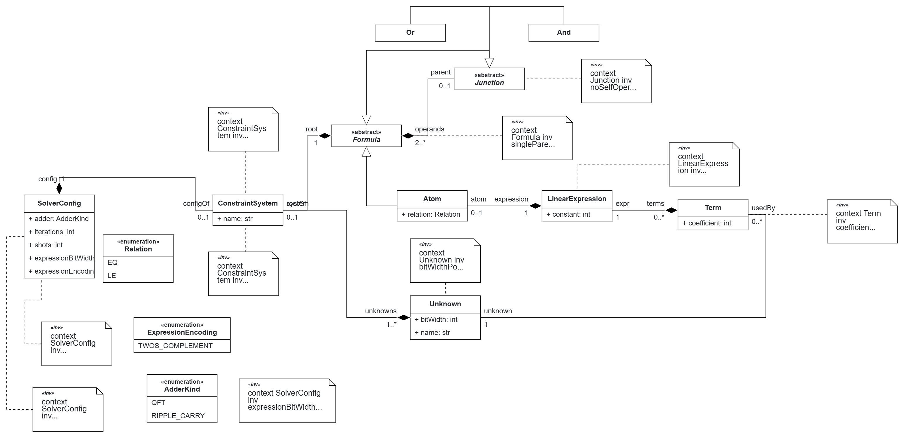

# TACS-G9 — QMDE: Knapsack Feasibility (Class C2)

Quantum Model-Driven Engineering assignment (TACS 2026/27, FEUP).
Problem: **knapsack feasibility** — given items with weights and values, is there a choice whose total weight is ≤ C and total value is ≥ V?
Class C: the problem is translated into a system of **linear integer constraints** and solved with **Grover search** using reversible adders and comparators.

## Transformation chain

| Layer | Artefact | Status |
|---|---|---|
| Problem DSL | Knapsack problem metamodel + OCL ([`problem_metamodel.py`](problem_dsl/problem_metamodel.py)) | Part I |
| Solution DSL | Linear integer constraints metamodel + OCL ([`solution_metamodel.py`](solution_dsl/solution_metamodel.py)) | Part I |
| T1 | Problem model → solution model | Part II |
| T2 | Solution model → BESSER quantum circuit model | Part II |
| T3 | Quantum model → Qiskit code (BESSER generator) | Part II |

## Setup

Requires Python 3.11–3.12 (the BESSER fork needs ≥3.11 and does not install on 3.13).

```bash
python -m venv venv
source venv/bin/activate        # Windows: venv\Scripts\activate
pip install -r requirements.txt
python -c "import besser; print('BESSER ok')"
```

On Windows, if the BESSER install fails with `Filename too long`, run
`git config --global core.longpaths true` once and install again.

BESSER is installed from the course fork: [jacomecunha/BESSER](https://github.com/jacomecunha/BESSER)

## Run T1 and check the result

From the repo root, with the venv active:

```bash
python -m transformations.t1                 # T1 on every instance in models/instances.py + check; saves out/t1/<instance>_solution.py
python -m transformations.t1 f4 f4_multi     # only some instances
python -m transformations.t1 problem.py solver_config.py   # editor exports, each defining object_model
```

The check reads the T1 output back (all 0/1 assignments satisfying every `e <= 0` atom) and compares it with the
brute-force baseline. Expected output: `OK` on every line (`toy`, `tiny`, `f4`, `f4_none`, `f7_sub5`, `f4_multi` with 5 solutions).
Any `FAIL` means T1 changed the problem's meaning.

## Run T2 and check the result
 
From the repo root, with the venv active:
 
```bash
python -m transformations.t2                 # T1 -> T2 -> Qiskit code (BESSER generator) -> Aer on every instance in models/instances.py + check
python -m transformations.t2 f4 f4_multi     # only some instances
```
 
The check builds the circuit with T2 and compares it with the T1 solution model (which T1 already checks against the
brute-force baseline): the oracle (simulated classically on all 2^n inputs) must mark exactly the solutions and leave every
ancilla at `0`; then, for instances with some but not all assignments as solutions and at most 20 qubits, the generated Qiskit
script is run on Aer and more than 70% of the shots must decode to a valid assignment. Expected output: `oracle OK` on every
line, plus `Aer <valid>/<shots> valid` (about 94-97%) on the simulated ones (`toy`, `tiny`, `f4`, `f4_multi`);
`f4_none` (no solution) and `f7_sub5` (25 qubits) only get the oracle check. Any assertion error means T2 changed the problem's meaning.
 
```
toy      n=3 qubits=15 B=4 solutions=1 oracle OK | Aer 980/1024 valid, top=['a', 'b']
f4_none  n=4 qubits=20 B=6 solutions=0 oracle OK
```
 
T2 is in [`transformations/t2.py`](transformations/t2.py): `t2(solution_model)` returns the BESSER circuit and its
qubit layout; `decode_items(bitstring, layout)` maps a measured bitstring back to item names.

## Explicit solver configuration

T1 takes two model inputs: `transform(problem_model, configuration_model)`.
The configuration model contains exactly one `SolverConfig`, T1 copies it into
the solution model with a trace link to the input object. Each constraint system
must own one config. T1/T2 have no solver defaults or iteration overrides.

[`models/solver_configs.py`](models/solver_configs.py) defines the configurations
used by the CLI, demo and self-checks, separately from the problem instances:

| Instance | Grover rounds | Expression bits |
|---|---:|---:|
| toy | 2 | 4 |
| tiny | 3 | 5 |
| f4 | 3 | 6 |
| f4_multi | 1 | 6 |
| f4_none | 0 | 6 |
| f7_sub5 | 4 | 8 |

Each also explicitly sets `shots=1024`, `adder=RIPPLE_CARRY` and
`expressionEncoding=TWOS_COMPLEMENT`. Rounds were selected from the classical
baseline's solution counts, outside the transformations. Zero rounds are valid.
`expressionBitWidth` controls both shared arithmetic registers; T2 rejects a
width that cannot hold every atom's full signed range rather than widening it.
QFT is modelled but explicitly rejected by T2 until implemented.
Unknown widths remain explicit on `Unknown.bitWidth`: T1 sets them to 1 because
this is **0/1** knapsack, not a configurable change to the problem's domain.

For custom models, use `make_config` from
[`models/solver_configs.py`](models/solver_configs.py), supplying every setting,
or export an equivalent `SolverConfig` object model from the editor.
[`docs/transformations.md`](docs/transformations.md) includes an executable example.

Regression checks (no additional test dependencies):

```bash
python -m unittest validation.test_solver_config
```

## Run the whole chain (demo)

```bash
python -m demo                 # all instances in models/instances.py (about 40 s)
python -m demo f4 f4_multi     # only some instances
```

For each instance: classical baseline → T1 → T2 → Qiskit code (BESSER generator) → Aer (up to 20 qubits) → measured
bitstrings decoded to item names → comparison with the baseline. It prints a table and writes `out/validation.md`
(success probability measured vs. theory, oracle calls, most frequent answer). The number of Grover rounds comes
from each instance's solver configuration model (`models/solver_configs.py`), checked against the baseline's M by
`validation/test_solver_config.py`; a `(!)` in the Rounds column would mean the rounds
stored in the solution model differ from that optimum.
Everything under `out/` is generated and git-ignored.

## Part I deliverables

| Deliverable | Reference | Status |
|---|---|---|
| Problem DSL metamodel + 5 OCL invariants | [`problem_dsl/problem_metamodel.py`](problem_dsl/problem_metamodel.py) | Done |
| Solution DSL metamodel + OCL invariants | [`solution_metamodel.py`](solution_dsl/solution_metamodel.py) | Done |
| Problem DSL class diagram (with OCL) | [`problem_dsl/problem_class-diagram.png`](problem_dsl/problem_class-diagram.png) | Done |
| Solution DSL class diagram (with OCL) | [`solution_dsl/solution_class-diagram.png`](solution_dsl/solution_class-diagram.png) | Done |
| Concept lists (problem + solution DSL) and problem → solution mapping, with references | [`docs/concept_list.md`](docs/concept_list.md) | Done |
| Hand-built example models (problem + solution) | [Object tables, links, and expected T1 output](docs/example_object_models.md) | Done |
| Test instances (benchmark selection) | [`instances/instances.md`](instances/instances.md) | Done |
| Report | [`docs/report_part1.md`](docs/report_part1.md) | Done |
| LLM usage log | [`LLM_LOG.md`](LLM_LOG.md) | Done |

### Diagrams

The PNG diagrams are Part I snapshots; the Python metamodel and editor JSON
include the current mandatory solver config, expression width and encoding.

**Problem DSL**



**Solution DSL**



## Part II deliverables

Deadline: November 11 (assignment §7.4).

| Deliverable | Reference | Status |
|---|---|---|
| M2M transformation T1 (problem → solution model) | [`transformations/t1.py`](transformations/t1.py) | Done (self-check vs brute force; run `python -m transformations.t1`) |
| M2M transformation T2 (solution → BESSER quantum model) | [`transformations/t2.py`](transformations/t2.py) | Done (oracle checked on all 2^n inputs + Aer; run `python -m transformations.t2`) |
| Qiskit code generated with the BESSER M2T generator | `out/t3/<instance>/qiskit_circuit.py` (generated by `python -m demo`) | Done |
| Test instances written in the problem DSL (≥3, incl. several and no solutions) | [`models/instances.py`](models/instances.py) | Done |
| Working demo with a single documented command | [`demo.py`](demo.py) | Done (`python -m demo`) |
| Classical baseline (brute force + DP): the correct answer for each instance | [`validation/baseline.py`](validation/baseline.py) | Done |
| Validation: Aer simulation results vs. the classical baseline (success probability, oracle calls) | `out/validation.md` (written by `python -m demo`) | Done: measured within about 1 point of theory on every simulated instance; `f7_sub5` (25 qubits) is oracle-checked only |
| Report (~2 pages) | [`docs/report_part2.md`](docs/report_part2.md) | In progress (instances, baseline, validation, limitations written; transformations to do) |
| LLM usage log | [`LLM_LOG.md`](LLM_LOG.md) | In progress (Part II entries being added by each member) |

## Structure

| Folder | Content |
|---|---|
| [`problem_dsl/`](problem_dsl/) | Problem metamodel + OCL |
| [`solution_dsl/`](solution_dsl/) | Solution metamodel + OCL |
| [`models/`](models/) | Problem DSL object models of the test instances |
| [`validation/`](validation/) | Classical baseline and validation |
| [`instances/`](instances/) | Test instances + brute-force checker |
| [`docs/`](docs/) | Reports (incl. [`report_part2.md`](docs/report_part2.md)), concept tables, diagrams |
| [`LLM_LOG.md`](LLM_LOG.md) | LLM usage log |

## Group

| Student no. | Name |
|---|---|
| 202205682 | João Francisco Costa Cordeiro |
| 202108696 | Lino Branco Vaz |
| 202206289 | Nuno Pinho Fernandes |
| 202108852 | Inês Martin Soares |
